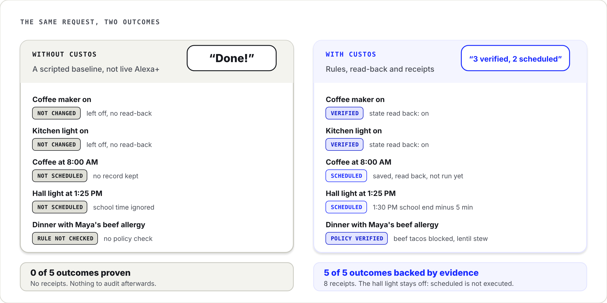
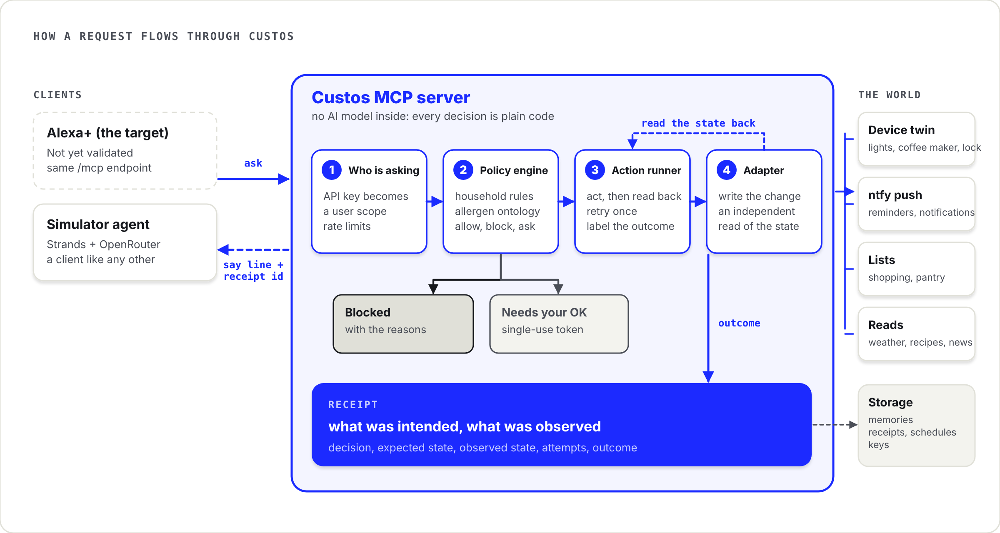
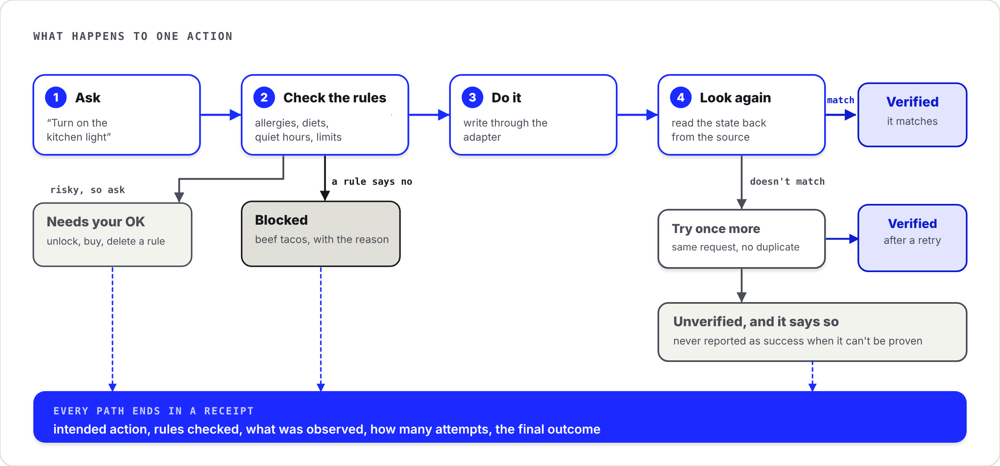
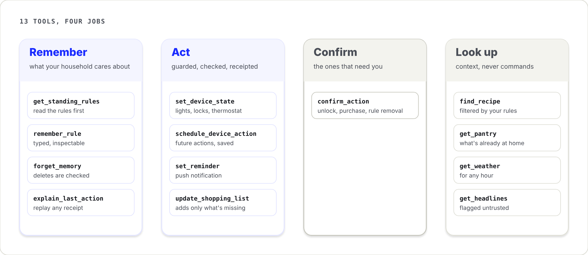
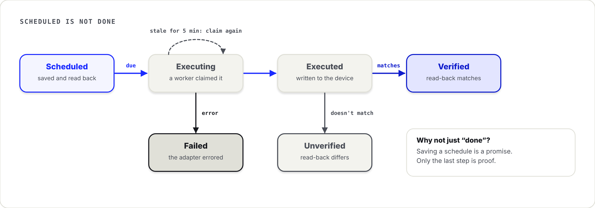
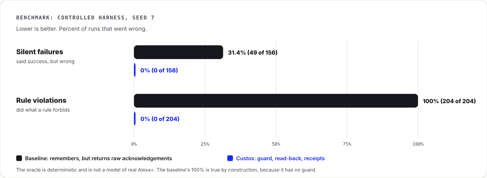

<div align="center">

# Custos

**Your assistant says "Done!" Custos makes it prove it.**

An open-source MCP server that makes a home assistant remember your family's rules, check them before it acts, and show evidence afterwards.

[](LICENSE)
[](https://modelcontextprotocol.io)
[](package.json)
[](https://amazonappdev2026.devpost.com/)

[**Live simulator**](https://custos-one-black.vercel.app) · [Architecture](docs/ARCHITECTURE.md) · [API](docs/API.md) · [Benchmark](docs/BENCHMARK.md) · [Friction log](docs/FRICTION_LOG.md) · [Product feedback](docs/PRODUCT_FEEDBACK.md)

</div>

---

## The 30-second version

Ask an assistant to do five things in one sentence:

> *"Turn on the coffee maker and kitchen light now, schedule coffee for 8am, turn on the hall light 5 minutes before my daughter is back from school, and prepare dinner for me and my daughter."*

A typical assistant answers **"Done!"**, and nothing is proven. The coffee maker may still be off, nothing may be scheduled, and dinner may be beef for a child with a beef allergy.

Custos sits between the assistant and your home, and changes what "done" means:

<p align="center"></p>

<details><summary>Same comparison as a table</summary>

| | Alexa+ without Custos (scripted baseline) | With Custos |
|---|---|---|
| Coffee maker and kitchen light on | Not changed, no device write | **Verified.** State read back as `on` |
| Coffee at 8:00 AM | Not scheduled | **Scheduled.** Row persisted and read back |
| Hall light before school ends | Not scheduled, rule not applied | **Scheduled for 1:25 PM** (1:30 PM school end minus 5 minutes) |
| Dinner for two | Rule not checked | **Policy verified.** Beef tacos blocked, lentil stew chosen |
| Shopping list, recipe, notification | Not attempted | Only missing items added; notification **accepted by provider**, delivery reported as unconfirmed |
| What it tells you | "Done!" | What the evidence supports, and what it does not |

</details>

The baseline is a controlled simulation, not a measurement of live Alexa+. Device state comes from a simulated device twin. The verification pipeline is real and works against any adapter that supports read-back.

### Three promises

| 🧠 It remembers | 🛡️ It checks | 🧾 It proves |
|---|---|---|
| "Maya is allergic to beef" is stored once as a rule, not as a sentence the assistant may forget. | Before anything runs, the rule is checked. Beef tacos are blocked, lentil stew is chosen. | Every action is read back from the device and recorded. You can ask "what did you just do?" and get the evidence. |

**[Open the simulator](https://custos-one-black.vercel.app)**, press *Play comparison*, and compare the two runs.

---

## Contents

- [Why this exists](#why-this-exists)
- [How it works](#how-it-works)
- [What you get](#what-you-get)
- [Quick start](#quick-start)
- [Connect an MCP client](#connect-an-mcp-client)
- [Evidence: benchmark](#evidence-benchmark)
- [Repository map](#repository-map)
- [Security model](#security-model)
- [Honest limits](#honest-limits)
- [Roadmap](#roadmap)
- [Contributing](#contributing)
- [For hackathon reviewers](#for-hackathon-reviewers)
- [Documentation index](#documentation-index)
- [License and credits](#license-and-credits)

---

## Why this exists

Public reports describe a recurring gap in voice assistants: they can understand a request without remembering its constraints, executing every step, or proving the outcome. These are individual reports, not a survey, and they do not show that every user is affected. Custos treats them as problem evidence.

| What users report | Source | What Custos does about it |
|---|---|---|
| Alexa+ responds as if a command was done while controlling the wrong light or failing to move blinds | [Amazon forum](https://www.amazonforum.com/s/question/0D5Kf00003VKeSFKA1/after-alexa-most-of-my-smart-home-commands-no-longer-functions-as-previously?language=en_US) | Reads device state back after every write. An acknowledgement is not proof |
| Reminders and timed routines stop working after an upgrade | [Amazon forum](https://www.amazonforum.com/s/question/0D5at00000Tc2ukCAB/alexa-early-access-a-total-failure?language=en_US) | Stores schedules durably, with separate `scheduled`, `executed` and `verified` states |
| Routines change behaviour after the Alexa+ upgrade | [r/alexa](https://www.reddit.com/r/alexa/comments/1s4x1np/we_last_3_days_with_alexa/) | Keeps explicit rules and routines. Never invents extra actions |
| Routines silently skip actions and are hard to diagnose | [r/alexa](https://www.reddit.com/r/alexa/comments/1wbmeqx/alexa_has_somehow_gotten_worse_at_the_one_thing_i/) | Writes a receipt per action, so failure and success look different |
| Taught context disappears between interactions | [r/alexa](https://www.reddit.com/r/alexa/comments/1sd76vb/alexa_has_memory_loss_after_3_days/) | Stores rules as typed, inspectable records and retrieves them at task time |
| A task is forgotten during follow-up | [r/alexa](https://www.reddit.com/r/alexa/comments/1wskd0d/forgetting_tasks_and_started_asking_personal/) | Keeps task state apart from conversational wording |
| Memory and context stay inconsistent for complex tasks | [The Verge review](https://www.theverge.com/tech/1007565/amazon-alexa-plus-review-one-year-echo-show-dot-max) | Retrieves context before planning and reports partial completion honestly |

Custos is not affiliated with or endorsed by Amazon.

---

## How it works

**Policy enforcement is code at the tool boundary, not a sentence in a system prompt.** The model proposes. Deterministic application code decides whether a guarded action may run, then checks the outcome.

<p align="center"></p>

1. **Remember.** Household rules are stored as typed records: allergens, diets, quiet hours, device limits, confirmation requirements.
2. **Evaluate.** `evaluate()` checks the proposed action against those rules. Severe allergens fail closed.
3. **Act.** Allowed actions go through the runner to an adapter.
4. **Verify.** The runner polls the resulting state, retries once idempotently, and labels the outcome `verified`, `verified_after_retry` or `unverified`.
5. **Receipt.** The decision, the expected state and the observed state are recorded. `explain_last_action` replays them.

### One action, start to finish

<p align="center"></p>

Every tool returns the same envelope. Its `outcome` is one of `ok`, `verified`, `verified_after_retry`, `unverified`, `blocked`, `needs_confirmation`, `unsupported` or `error`. It also carries a short speakable `say` line for the assistant to read verbatim.

The server contains no LLM. The simulator's agent (Strands plus OpenRouter) is a client of the same `/mcp` endpoint that any other MCP client would use.

---

## What you get

**13 MCP tools**, all in [`src/tools/`](src/tools):

<p align="center"></p>

| Group | Tools | Notes |
|---|---|---|
| Memory | `get_standing_rules`, `remember_rule`, `forget_memory`, `explain_last_action` | Typed rules. Rules from external sources land dormant. Deleting is verified by re-query |
| Actions | `set_device_state`, `set_reminder`, `update_shopping_list`, `schedule_device_action` | Guard, act, read back, retry once, receipt. Idempotent per user, tool, arguments and minute |
| Accountability | `confirm_action` | Two-step confirmation for unlocks, purchases and safety-rule removal |
| Reads | `find_recipe`, `get_weather`, `get_headlines`, `get_pantry` | Recipes are policy-filtered. Headlines are flagged `untrusted` |

Also included:

- **A simulator** (`simulator/`): a side-by-side comparison of the baseline and Custos on one request, with a device-twin truth panel and receipts. It is a client, not the product.
- **A benchmark** (`bench/`): seeded fault injection, Wilson confidence intervals, 60 hand-labelled recipes, committed raw results.
- **Multi-tenant auth**: hashed API keys, tenant-scoped queries, per-key rate limits.
- **A scheduled-action worker**: claims due schedules, writes to the device twin, then records `executed` and `verified` as separate states.

<p align="center"></p>

---

## Quick start

You need **Node.js 22.19 or newer** and npm. No account or API key is needed for the first run. Without Supabase credentials the server uses in-memory storage, and without an OpenRouter key the simulator runs in replay mode.

```bash
git clone https://github.com/Vitoraos/Custos.git
cd Custos
npm ci
npm ci --prefix simulator/web
npm run web:build
npm run dev
```

Open **http://localhost:3000**. One process serves the API, the MCP endpoint and the built simulator.

Check your setup:

```bash
npm run check        # type-check, Biome lint, unit and integration tests
npm run web:build    # build the simulator UI
npm run web:tokens   # design-token discipline check
```

For UI work, run `npm run web:dev` in a second terminal. Vite serves on port 5173 and proxies API calls to port 3000.

### Optional: persistence and live models

| You want | Do this |
|---|---|
| Data that survives restarts | Copy `.env.example` to `.env`. Set `SUPABASE_URL` and `SUPABASE_SERVICE_ROLE_KEY`. Apply `infra/migrations/001_v3.sql`, then `003_scheduled_actions.sql`, then run `npm run db:seed`. Keep the service-role key server-side only |
| Live model conversations in the simulator | Set `OPENROUTER_API_KEY`. The free tier is limited to 20 requests a minute and 50 a day, so replay mode stays available |
| Real push notifications | None needed. The `ntfy.sh` adapter is keyless |

Setting only one of the two Supabase variables is an error by design. A half-configured store would otherwise fail in confusing ways.

### Configuration reference

| Variable | Default | Purpose |
|---|---|---|
| `PORT` / `HOST` | `3000` / `0.0.0.0` | Server bind address |
| `ALLOWED_ORIGINS` | `http://localhost:5173` | Origin allow-list for the MCP endpoint |
| `SUPABASE_URL`, `SUPABASE_SERVICE_ROLE_KEY` | unset | Persistent storage. Unset means in-memory |
| `OPENROUTER_API_KEY`, `OPENROUTER_MODEL` | unset, `openrouter/free` | Simulator agent |
| `SIM_DAILY_BUDGET_CALLS`, `SIM_SESSION_MAX_TURNS` | `500`, `30` | Simulator spend guards |
| `NTFY_BASE_URL`, `RSS_FEED_URL` | public defaults | Override for self-hosting |

---

## Connect an MCP client

Custos speaks MCP over Streamable HTTP, stateless, at `/mcp`.

```text
URL:      http://localhost:3000/mcp
Header:   Authorization: Bearer cf_<your key>
Header:   Accept: application/json, text/event-stream
```

The `Accept` header is required by the transport. Without it the server returns `-32000 Not Acceptable`.

Create a key (this needs database configuration):

```bash
npm run keys:create -- --user demo --mode forge
```

`--mode forge` gives the full Custos path. `--mode baseline` returns raw acknowledgements with no guard or verification, which is the control used by the A/B comparison.

Smoke-test a running server:

```bash
npm run smoke -- --base http://localhost:3000 --key cf_<your key>
```

Clients are told to call `get_standing_rules` first and to read each `say` line verbatim. `user_id` is never a tool argument. Scope comes from the key. See the [API reference](docs/API.md).

> **Alexa+ status.** Amazon documents an MCP add-on path for Alexa+. This repository has not validated add-on onboarding or compatibility, so do not treat it as an Alexa+-ready integration. The same `/mcp` endpoint is what such an integration would call.

---

## Evidence: benchmark

The L1 harness sends the same simulated household tasks through two configurations, with the same fault seeds. The baseline keeps memory but returns raw acknowledgements. Custos adds the guard, read-back and receipts.

<p align="center"></p>

| Metric | Custos | Baseline |
|---|---:|---:|
| Silent failures (reported success, state did not match) | **0 / 156** (0.0%) | 49 / 156 (31.4%) |
| Constraint violations | **0 / 204** (0.0%) | 204 / 204 (100%) |
| False blocks of compliant actions | 0 / 576 (0.0%) | 0 / 576 (0.0%) |
| Unverified outcomes disclosed honestly | **13 / 13** | n/a |
| Untrusted rule-write attempts accepted | 0 / 3 | 0 / 3 |
| Latency p50 / p95 (device actions) | 309 / 4,442 ms | 0 / 1 ms |

Run: L1 oracle, seed 7, 9 October 2026. Read these numbers carefully:

- The oracle is deterministic. It calls the right tool and trusts the acknowledgement. It is **not** a model of real Alexa+ behaviour.
- The baseline's 100% violation rate is true **by construction**, because it has no guard. It shows the structural difference, not a measured rate for any real assistant.
- Only 5% of injected faults are recoverable by retry (6 of 120). Faults such as an offline device cannot be fixed by retrying. Custos is built to disclose these, not to hide them.
- Three injection attempts is a preliminary result, not a security estimate.
- Latency overhead is the cost of checks and read-back. The near-zero baseline reflects the simplified oracle, not equal inference work.

Full definitions, confidence intervals, scenario families and limits are in [docs/BENCHMARK.md](docs/BENCHMARK.md). Reproduce with:

```bash
npm run bench -- --quick
npm run bench:report
```

---

## Repository map

```text
src/
  core/          policy.ts, verify.ts, receipts.ts, matcher.ts, ontology/, scheduledWorker.ts
  adapters/      devices/twin.ts, ntfy.ts, openmeteo.ts, mealdb.ts, rss.ts, lists.ts
  tools/         memory.ts, actions.ts, accountability.ts, reads.ts, scheduling.ts
  storage/       store.ts (interface + in-memory), supabaseStore.ts, memories.ts
  server.ts      one Hono process: /mcp, /health, /sim/*, static UI
simulator/
  api/           showcase, guest keys and budget, agent orchestration, routes
  web/           React + Vite comparison UI
bench/           runner, report generator, labelled data, committed results
infra/           schema, migrations, seed data, Render config
test/            unit, integration, fakes, live adapter tests
scripts/         key creation, smoke test, preflight, replay recorder
docs/            architecture, API, benchmark, demo script, friction log, feedback
```

Where to start reading the core idea: [`src/core/policy.ts`](src/core/policy.ts), then [`src/core/verify.ts`](src/core/verify.ts), then [`src/core/receipts.ts`](src/core/receipts.ts).

### Adapters

| Adapter | Used for | Notes |
|---|---|---|
| Device twin (`devices/twin.ts`) | Device writes and read-back | Seeded faults: `lost_ack`, `delayed`, `offline`, `flaky` |
| ntfy | Real push notifications | Reports provider acceptance. Delivery is not observable before the message fires |
| Open-Meteo | Weather | Validated, cached, stamped with `fetchedAt` and `source` |
| TheMealDB | Recipes | A clearly marked fallback dataset is used if the API is down |
| RSS | Headlines | Always flagged `untrusted` and never stored |

Writing a new adapter means implementing a write and an independent read. The verification pipeline then works unchanged.

---

## Security model

| Concern | Mitigation |
|---|---|
| Cross-tenant access | User scope is derived from the API key, never from a tool argument. Every query is scoped by user. Row-level security is on |
| Key theft | 256-bit random keys, SHA-256 hashed at rest, shown once, revocable. Guest keys expire after 24 hours |
| Secrets | `.env` only, placeholders in `.env.example`, gitleaks in CI. The service-role key never reaches the browser |
| Dangerous actions | Unlock, purchase and safety-rule removal need a two-minute, single-use, argument-bound confirmation token |
| Prompt injection | External content is marked `untrusted` and cannot write rules. External rules land dormant |
| Abuse | Origin allow-list, per-key and per-IP rate limits, Zod length and range caps, tool timeouts |

Details and residual risks are in [SECURITY.md](SECURITY.md). To report a vulnerability, open an issue titled `[security]` without exploit details, or contact the maintainer, and allow seven days before disclosure. This is a hackathon prototype, not a certified system.

---

## Honest limits

- Devices are simulated. No physical device or live Alexa+ session is involved.
- Scheduled means persisted. Executed and verified are separate states, and the demo never claims a physical device changed.
- Notification verification confirms provider acceptance, not delivery to a device.
- Ingredient matching uses heuristics. It is not medical or allergen-safety advice.
- Benchmark results come from a controlled harness and do not generalise to real assistants.
- Free-tier services (OpenRouter, ntfy, Supabase, Render) can be slow or rate-limited.
- The server controls what a tool says and records. It cannot control what the assistant says afterwards, which is why `say` lines, server instructions and receipts exist.

---

## Roadmap

- [ ] Validate the Alexa+ MCP add-on path end to end
- [ ] Add a real device adapter beyond the twin (for example Matter or Home Assistant)
- [ ] Grow the injection corpus well past three attempts
- [ ] Publish repeated model-driven (L2) benchmark runs with model and version details
- [ ] Compare latency against a baseline with equivalent model inference
- [ ] Add halal and kosher ontology packs, and a spend cap

---

## Contributing

Contributions are welcome, from typo fixes to new adapters. Good first areas: a new device adapter, more ontology coverage, more benchmark scenarios, and documentation.

Ground rules:

1. Enforce policy and authorisation in code, not only in prompts.
2. Add or update tests for safety constraints, failure paths and tenant isolation.
3. Never report an action as verified unless the adapter supplied evidence.
4. Label simulated behaviour as simulation. Do not imply live Alexa+ integration.
5. Run the checks before opening a pull request:

```bash
npm ci && npm ci --prefix simulator/web
npm run check
npm run web:build
npm run web:tokens
```

If a check cannot run because a service or credential is unavailable, say so in the pull request instead of presenting it as passing. Read the [architecture](docs/ARCHITECTURE.md), [API contract](docs/API.md) and [security notes](SECURITY.md) before changing tool boundaries or authentication.

---

## For hackathon reviewers

**Tracks:** Amazon *Build, Ship, Shape*: Alexa+ track, AWS Builder mini challenge (Strands Agents SDK), and Open Source mini challenge (MIT).

You do not need to install anything to evaluate Custos.

| To judge | Look at |
|---|---|
| Idea and impact | [Why this exists](#why-this-exists) and the table at the top |
| Technical implementation | [`policy.ts`](src/core/policy.ts), [`verify.ts`](src/core/verify.ts), [`receipts.ts`](src/core/receipts.ts), [`scheduledWorker.ts`](src/core/scheduledWorker.ts) and the tests in [`test/`](test) |
| Evidence | [Benchmark](docs/BENCHMARK.md), including its limits |
| Design | The [live simulator](https://custos-one-black.vercel.app). Press *Play comparison* |
| Demo narration | [docs/DEMO_SCRIPT.md](docs/DEMO_SCRIPT.md) |
| Friction log (optional bonus) | [docs/FRICTION_LOG.md](docs/FRICTION_LOG.md) |
| Product feedback on every tool used | [docs/PRODUCT_FEEDBACK.md](docs/PRODUCT_FEEDBACK.md) |
| What was built in the window | [docs/WHAT_CHANGED.md](docs/WHAT_CHANGED.md) |

The AWS service used is the Strands Agents SDK, which runs the simulator's model-driven comparison path. The server itself is LLM-free by design.

---

## Documentation index

| Document | Purpose |
|---|---|
| [docs/ARCHITECTURE.md](docs/ARCHITECTURE.md) | Request lifecycle, key files, scheduled actions |
| [docs/API.md](docs/API.md) | Tool contracts and the result envelope |
| [docs/BENCHMARK.md](docs/BENCHMARK.md) | Method, metrics, results, limits |
| [SECURITY.md](SECURITY.md) | Threat model and disclosure |
| [docs/DEMO_SCRIPT.md](docs/DEMO_SCRIPT.md) | Three-minute demo narration |
| [docs/FRICTION_LOG.md](docs/FRICTION_LOG.md) | Developer friction, structured per entry |
| [docs/PRODUCT_FEEDBACK.md](docs/PRODUCT_FEEDBACK.md) | Feedback on each tool and SDK used |
| [docs/WHAT_CHANGED.md](docs/WHAT_CHANGED.md) | What was built during the hackathon window |

---

## License and credits

[MIT](LICENSE). © Vitoraos.

Previously named ContextForge. Some package names, deployment labels and archived documents still use that name.

Built with [FastMCP](https://github.com/punkpeye/fastmcp), the [Strands Agents SDK](https://strandsagents.com), [Supabase](https://supabase.com), [Hono](https://hono.dev), [React](https://react.dev) and [Vite](https://vite.dev). External data from [ntfy](https://ntfy.sh), [Open-Meteo](https://open-meteo.com) and [TheMealDB](https://www.themealdb.com).
